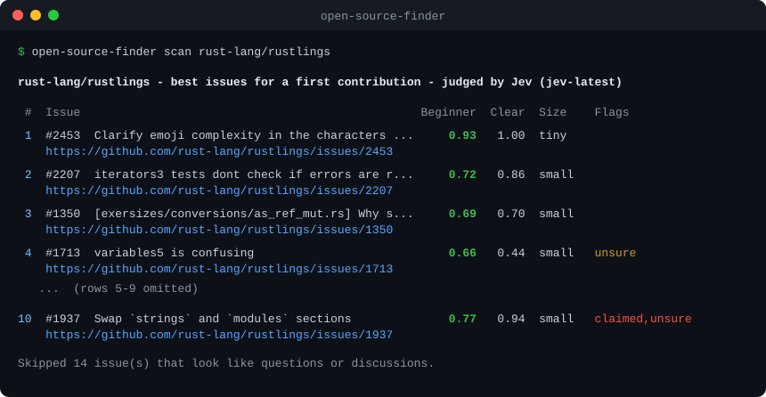
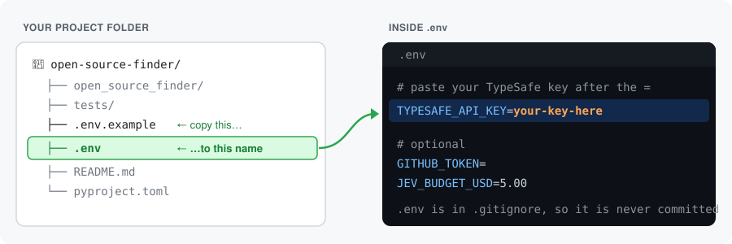
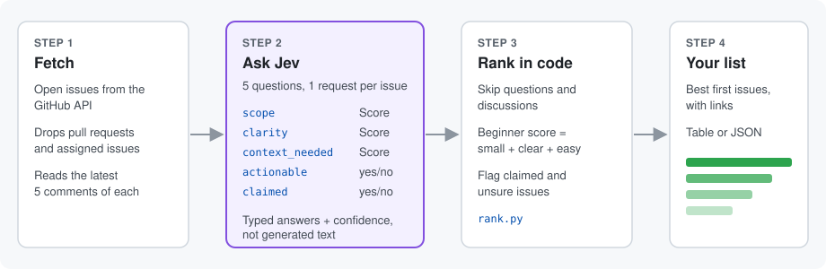

# open-source-finder

[](https://github.com/Tanishk901/open-source-finder/actions/workflows/test.yml)
[](https://github.com/Tanishk901/open-source-finder/releases)
[](LICENSE)

[](https://docs.typesafe.ai)

**Find the open issues in any GitHub repo that suit a first-time contributor.**

Most repos have dozens of open issues, and only a few are a good first contribution. The
`good first issue` label helps, but it's often missing, out of date, or on issues someone
already took. `open-source-finder` reads each open issue and ranks them by how small, clear, and
self-contained they are. It also flags issues that someone is already working on.



Real output from a scan of [rust-lang/rustlings](https://github.com/rust-lang/rustlings) on
4 October 2026 (rows 5–9 left out). Your results will change as issues are opened and closed.

Built with [Jev](https://docs.typesafe.ai), TypeSafe AI's System One model, which answers
narrow questions with typed, calibrated answers instead of generated text.

> **Note:** This project's code is open source (MIT). Jev itself is a hosted model, so judging
> real issues needs a TypeSafe API key and costs a small amount per issue (see [Cost](#cost)).
> You can also judge issues for free with a [local model](#run-free-with-a-local-model-ollama),
> or try the tool with `--mock`.
> This is a community project, not affiliated with TypeSafe AI.

**New in 0.2.0:** a free [local-model judge](#run-free-with-a-local-model-ollama), saved
judgments so re-scans are mostly free, and newcomer-labeled issues judged first. See the
[changelog](CHANGELOG.md) for everything.

## Contents

- [Install](#install)
- [Add your API key](#add-your-api-key)
- [Use](#use)
- [Run free with a local model (Ollama)](#run-free-with-a-local-model-ollama)
- [How it works](#how-it-works)
- [What Jev catches](#what-jev-catches)
- [Cost](#cost)
- [Troubleshooting](#troubleshooting)
- [Roadmap](#roadmap)
- [Contributing](#contributing)

## Install

You need Python 3.10 or newer and git.

**Windows (PowerShell):**

```powershell
git clone https://github.com/Tanishk901/open-source-finder
cd open-source-finder
python -m venv .venv
.venv\Scripts\python -m pip install -e .
```

**macOS / Linux:**

```bash
git clone https://github.com/Tanishk901/open-source-finder
cd open-source-finder
python3 -m venv .venv
.venv/bin/python -m pip install -e .
```

This installs the `open-source-finder` command inside the project's own `.venv` folder, so
it doesn't affect the rest of your system.

To install a specific release instead of the latest code, clone that version's tag, e.g.
`git clone --branch v0.2.0 https://github.com/Tanishk901/open-source-finder`. All versions
are listed on the [releases page](https://github.com/Tanishk901/open-source-finder/releases).

## Add your API key



1. Get a key from the [TypeSafe console](https://console.typesafe.ai/keys).
2. In the `open-source-finder` folder, copy `.env.example` to a new file named `.env`:

   ```bash
   cp .env.example .env      # macOS / Linux / Git Bash
   copy .env.example .env    # Windows Command Prompt
   ```

3. Open `.env` and replace `paste_your_key_here` with your key:

   ```ini
   TYPESAFE_API_KEY=your-key-here
   ```

`.env` is listed in `.gitignore`, so your key is never committed. The tool reads `.env` from
the folder you run it in, or else from the project folder. You can also set
`TYPESAFE_API_KEY` as an environment variable instead.

**Optional: GitHub token.** Without one, GitHub allows only 60 requests an hour, which is
about two scans. A free token raises this to 5,000:

1. Open [github.com/settings/personal-access-tokens/new](https://github.com/settings/personal-access-tokens/new).
2. Name it `open-source-finder` and set **Repository access** to **Public repositories (read-only)**.
   No other permissions are needed.
3. Click **Generate token**, then paste the token after `GITHUB_TOKEN=` in `.env`.

## Use

From the `open-source-finder` folder, run `scan` with any public repo, written as `owner/name`
or pasted as a GitHub link (`https://github.com/rust-lang/rustlings` works too).

**Windows (PowerShell):**

```powershell
.venv\Scripts\open-source-finder scan rust-lang/rustlings
```

**macOS / Linux:**

```bash
.venv/bin/open-source-finder scan rust-lang/rustlings
```

If you activate the virtual environment first (`.venv\Scripts\activate` on Windows,
`source .venv/bin/activate` on macOS/Linux), you can type just `open-source-finder`.
The examples below use that short form:

```bash
# Try it without any key (keyword rules instead of Jev, much less accurate):
open-source-finder scan pandas-dev/pandas --mock

# Show only the best 5 issues:
open-source-finder scan pandas-dev/pandas --top 5

# Machine-readable output, including every raw judgment:
open-source-finder scan pandas-dev/pandas --json > issues.json
```

**Reading the results:**

| Column | Meaning |
| --- | --- |
| **Beginner** | Overall fit for a first contribution, from 0 to 1. Higher is better. |
| **Clear** | How clearly the issue says what to do and how to check it, from 0 to 1. |
| **Size** | How big the change is: tiny, small, medium, large, or huge. |
| **Flags** | `claimed`: someone is on it, or maintainers declined it. `unsure`: Jev wasn't confident, so read it yourself. `beginner-label`: maintainers labeled it for newcomers (e.g. "good first issue", "first timers only", "E-easy"). |

| Option | Default | Meaning |
| --- | --- | --- |
| `--top N` | 10 | How many issues to show |
| `--max-issues N` | 30 | How many open issues to fetch and judge (one Jev request each) |
| `--all` | off | Also show issues judged too big or complex for a first contribution |
| `--json` | off | Print full results as JSON, including skipped issues and their scores |
| `--judge` | `jev` | Who judges the issues: `jev`, `ollama` (a local model), or `mock` |
| `--mock` | off | Shorthand for `--judge mock`: keyword rules, no API key needed |
| `--model` | depends on judge | For `jev`: `jev-latest` (default) or `jev-preview`. For `ollama`: any model you've pulled (default `qwen2.5:7b`) |
| `--no-cache` | off | Judge every issue again, even ones unchanged since the last scan |

## Run free with a local model (Ollama)

You can judge issues with a model running on your own computer instead of Jev. It's free,
needs no API key, and works offline once the issues are fetched.

1. Install [Ollama](https://ollama.com/download) and start it.
2. Pull a model. Models that are good at JSON work best; `qwen2.5:7b` (about 4.7 GB) is the
   default:

   ```bash
   ollama pull qwen2.5:7b
   ```

3. Scan with `--judge ollama`:

   ```bash
   open-source-finder scan rust-lang/rustlings --judge ollama
   open-source-finder scan rust-lang/rustlings --judge ollama --model llama3.1:8b
   ```

The local model gets exactly the same five questions as Jev (built from
[`judge.py`](open_source_finder/judge.py)), and the same ranking code turns its answers into
the list. Some things to expect:

- **Less accurate than Jev.** Local models pick a level for each question instead of giving
  calibrated answers, and they report no confidence, so the **unsure** flag never appears.
- **Slower.** Issues are judged one at a time; a 7B model on a laptop takes several seconds to
  a minute per issue. Use `--max-issues` to judge fewer.
- **Garbled answers are skipped.** If the model's reply can't be read, it's asked once more;
  if that fails too, the issue is left out and listed after the run.

Ollama is expected at `http://localhost:11434`. Set `OLLAMA_HOST` to use another address.
Saved judgments are kept per model, so Ollama and Jev answers never mix.

## How it works



1. **Fetch** open issues from the GitHub API. Issues with newcomer labels the repo uses
   (`good first issue`, `first timers only`, `E-easy`, `help wanted`, …) come first, then the
   newest issues fill up to `--max-issues`. Pull requests and assigned issues are dropped, and
   the latest 5 comments are read for each remaining issue. Labels only decide which issues get
   judged; they never change a score.
2. **Judge.** Each issue goes to Jev in one request with five questions that run in parallel:

   | Question | Type | What it asks |
   | --- | --- | --- |
   | `scope` | Score, 5 levels | One-line fix → cross-cutting redesign |
   | `clarity` | Score, 4 levels | Unclear request → outcome, verification, and location all stated |
   | `context_needed` | Score, 4 levels | Newcomer can do it → needs maintainer decisions |
   | `actionable` | Noul (yes/no) | A concrete code/docs/test change someone can start now, not a question, discussion, or issue still waiting on a maintainer decision? |
   | `claimed` | Noul (yes/no) | Do the comments show someone is on it, or that it was declined? |

3. **Rank** in plain code ([`rank.py`](open_source_finder/rank.py)):
   - Issues with `actionable < 0.5` are skipped.
   - The beginner score is `0.4 × small scope + 0.3 × clarity + 0.3 × low context needed`,
     each normalized to 0–1.
   - A beginner score below 0.45 → hidden as too big or complex (shown with `--all`).
   - `claimed > 0.6` → flagged **claimed** and sorted to the bottom.
   - Any Score answered with confidence below 0.3 → flagged **unsure**.

   These thresholds were tuned on 120 real issues from pandas, rust, freeCodeCamp, and ruff.
   - A newcomer label such as `good first issue` is shown as **beginner-label**, but it doesn't
     change the score, so you can compare Jev's view with the maintainers'.

   Jev answers the questions; the code decides what to do with the answers. To change the
   weights or thresholds, edit the constants at the top of `rank.py`.

## What Jev catches

Real examples from the first scans (October 2026):

- **Already claimed.** In `rust-lang/rustlings`, issue
  [#1937](https://github.com/rust-lang/rustlings/issues/1937) looks perfect for a beginner:
  small, and with a clarity of 0.94. But in its comments the maintainer says, *"I will take care
  of it before releasing v7, no help needed."* Jev flagged it **claimed**, so it was sorted to
  the bottom instead of being recommended.
- **Not a task.** In `fastapi/fastapi`, Jev skipped the pinned "Roadmap" issue and a
  promotional post. Both are open issues, but neither is something a contributor can fix.
- **Better than keywords.** The `--mock` keyword rules gave almost every rustlings issue the
  same score. Jev spread them from 0.30 to 0.93, with a tiny, clearly described docs fix at the
  top.

## Cost

Each judged issue is one Jev request of roughly 1,000–3,000 input tokens (issue bodies are cut
to 3,000 characters, and comments to 500 each). At Jev's listed price of $0.042 per million
input tokens, a 30-issue scan costs well under a cent. Check
[TypeSafe's docs](https://docs.typesafe.ai) for current pricing.

A spending cap is built in. Total spend is tracked in `~/.open-source-finder/spend.json`, and the
run stops before any request that could cross `$5.00` (set `JEV_BUDGET_USD` to change this).

Scanning the same repo again is mostly free: judgments are saved in
`~/.open-source-finder/judgments.json` and reused for any issue that hasn't changed on GitHub since
(no edits, label changes or new comments), as long as the model and the questions in
[`judge.py`](open_source_finder/judge.py) are the same. Saved judgments expire after 30 days. Use
`--no-cache` to judge everything again.

## Troubleshooting

| You see | What it means | Fix |
| --- | --- | --- |
| `The module '.venv' could not be loaded` (PowerShell) | You're not in the project folder. | `cd` into `open-source-finder` first, then run the command again. |
| `No TYPESAFE_API_KEY found` | There's no `.env`, or the key line still says `paste_your_key_here`. | Follow [Add your API key](#add-your-api-key), or try `--mock`. |
| `GitHub rate limit hit. It resets in about N minute(s).` | You've used GitHub's 60 requests an hour for unauthenticated users. | Add a free `GITHUB_TOKEN` (see [Add your API key](#add-your-api-key)), or wait. |
| `GitHub rate limit hit while reading comments, so N issue(s) were judged without them` | The limit ran out partway through. The scan still finished, but for the listed issues nobody checked whether someone has already claimed them. | Read those issues' comments yourself, or scan again once the limit resets. Those answers aren't saved, so the next scan judges them again with their comments. |
| `TypeSafe API error: ... Unknown model` | The `--model` name isn't one your account offers. | Use `jev-latest` (the default) or `jev-preview`. |
| `TypeSafe API error: ... 401` | The API key is wrong or was revoked. | Create a new key in the [TypeSafe console](https://console.typesafe.ai/keys) and update `.env`. |
| `Not found: /repos/...` | There's a typo in the repo name, or the repo is private. | Use the `owner/name` from the repo's GitHub URL. |
| `... spent of $5.00 limit; stopping.` | The spending cap was reached. | Raise `JEV_BUDGET_USD` in `.env` if you want to spend more. |
| `owner/repo` gives "Not found" | `owner/repo` is a placeholder. | Use a real repo, e.g. `rust-lang/rustlings`. |
| `GitHub rejected GITHUB_TOKEN` | The token in `.env` is wrong, expired, or revoked. | Create a new token, or delete the `GITHUB_TOKEN` line to run without one. |
| `... is not a GitHub repo` | The repo argument isn't `owner/name` or a GitHub link. | Copy the link from the repo's page on github.com. |
| `... is archived (read-only)` | The repo no longer accepts changes. | Pick an active repo. |
| `... doesn't use GitHub issues` | The repo turned GitHub issues off (e.g. `torvalds/linux` uses mailing lists). | Check the repo's README for how it takes contributions. |
| `Warning: ... spend.json was unreadable` | The spending record was damaged (e.g. the PC lost power mid-write). | Nothing to do: it was moved to `spend.json.bad` and a new total started. |
| `Can't reach Ollama at http://localhost:11434` | Ollama isn't installed or isn't running. | Install it from [ollama.com](https://ollama.com/download) and start it, or set `OLLAMA_HOST` if it runs elsewhere. |
| `Ollama doesn't have the model '...'` | That model hasn't been downloaded. | Run `ollama pull <model>`, or pick one you have (`ollama list`) with `--model`. |
| `Ollama took over 300s to answer one issue` | The model is too big for your computer. | Use a smaller model, e.g. `--model qwen2.5:3b`. |
| `Skipped N issue(s) whose answers the model garbled` | The local model gave unreadable answers twice. | Nothing to do for a few; if it's many, try a different model. |
| `Hid N issue(s) that look too big or complex` | Not an error: those issues scored under 0.45. | Add `--all` to see them anyway. |

## Roadmap

- [x] Judge issues with Jev
- [x] Judge issues with local models through Ollama, so the tool can run free and offline
- [x] Save judgments, so scanning a repo again only pays for issues that changed
- [ ] Test the local-model judge against real models, and tune its prompt
- [ ] Find repos for you: search GitHub by language for repos with open beginner issues, then scan the best few
- [ ] Compare judges on the same issues, to see which picks the best first contributions

Judges are pluggable. A judge is any class with `judge(repo, issue)` that returns a
[`Judgment`](open_source_finder/rank.py) (the same five answers, normalized to 0–1). To add one,
register it in `JUDGES` and `make_judge()` in [`cli.py`](open_source_finder/cli.py). The ranking
code doesn't change.

## Contributing

Contributions are welcome, including from first-time contributors. That's the point of this
project.

1. Fork the repo and clone your fork.
2. Install with the test extras, then run the tests:

   ```bash
   python -m venv .venv
   .venv/bin/python -m pip install -e ".[test]"     # Windows: .venv\Scripts\python ...
   .venv/bin/python -m pytest
   ```

   The tests use no network, no API key and no Ollama. They cover the ranking policy, GitHub
   fetching and errors, the saved-judgment cache, the budget cap, and the Jev and Ollama judges.
3. Make your change on a new branch, add or update a test if behavior changes, and open a pull
   request that explains what you changed and why.

**Project layout:**

| File | What it does |
| --- | --- |
| [`cli.py`](open_source_finder/cli.py) | Command-line options, running the scan, and printing the table or JSON |
| [`github.py`](open_source_finder/github.py) | Fetching issues and comments from the GitHub API |
| [`judge.py`](open_source_finder/judge.py) | The five Jev questions and turning answers into a `Judgment` |
| [`ollama.py`](open_source_finder/ollama.py) | The local-model judge: the same questions, asked through Ollama |
| [`rank.py`](open_source_finder/rank.py) | Weights, thresholds, flags, and sorting (pure code, no network) |
| [`cache.py`](open_source_finder/cache.py) | Saving judgments so unchanged issues aren't judged (or paid for) again |
| [`mock.py`](open_source_finder/mock.py) | Keyword-based judge for trying the tool without a key |
| [`budget.py`](open_source_finder/budget.py) | Loading `.env`, and the spending cap |

**Good places to start:** trying `--judge ollama` with a real model and reporting how it ranks
(see [Roadmap](#roadmap)), better mock rules, or tuning the thresholds in `rank.py` against
real repos. Add a line to [CHANGELOG.md](CHANGELOG.md) for any change users will notice.

## Credits

- [TypeSafe Python SDK](https://github.com/typesafe-ai/typesafe-sdk-python) (MIT)
- The budget helper is adapted from [jev-starter-examples](https://github.com/Tanishk901/jev-starter-examples)
- More Jev projects: [awesome-jev](https://github.com/heyjunpenn/awesome-jev) / [jevbest.com](https://jevbest.com)

## License

[MIT](LICENSE)
